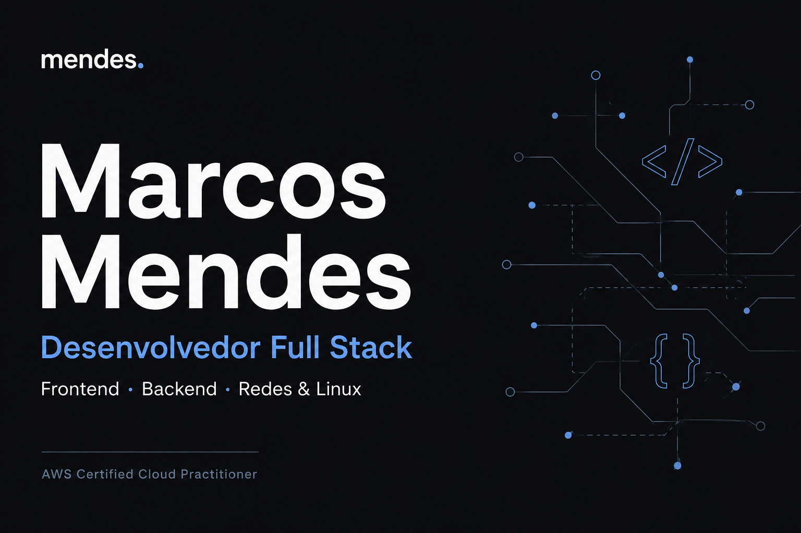
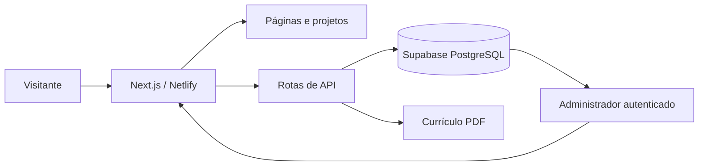

# Portfólio de Marcos Mendes

[](https://github.com/Mendes44/meuPortifolio/actions/workflows/ci.yml)
[](https://nextjs.org/)
[](https://www.typescriptlang.org/)
[](https://www.credly.com/badges/638d5aba-3345-4888-99eb-0746afccef7d/linked_in_profile)

Portfólio profissional de **Marcos Mendes**, especialista em TI com experiência em desenvolvimento, infraestrutura, redes, Linux, cloud e segurança. O site apresenta produtos SaaS, sites comerciais entregues a clientes, APIs, automações e laboratórios técnicos.

**Produção:** [marcosmendes.netlify.app](https://marcosmendes.netlify.app/)

**GitHub:** [github.com/Mendes44](https://github.com/Mendes44)
**LinkedIn:** [linkedin.com/in/marcosmendes44](https://www.linkedin.com/in/marcosmendes44/)



## Projetos em destaque

| Projeto | Tipo | Principais tecnologias | Demonstração |
| --- | --- | --- | --- |
| FixApp | SaaS multiempresa | Next.js, TypeScript, Supabase, PostgreSQL, PWA | [Abrir](https://fixapp-bay.vercel.app/) |
| Copa Cozinha | Site comercial | Next.js, React, Tailwind, Leaflet | [Abrir](https://copacozinha.vercel.app/) |
| Stok Atacadista | Site e painel de campanhas | HTML, CSS, JavaScript, Node.js, GA4 | [Abrir](https://www.stokoutlet.com.br/) |
| Tradição do Peixe | Site comercial | Vite, JavaScript, GTM, Consent Mode | [Abrir](https://tradicaodopeixe.com.br/) |
| Village Kids | Site comercial | HTML, CSS, JavaScript | [Abrir](https://villagekidsbh.com.br/) |
| Chico do Peixe | Site comercial | Next.js, React, TypeScript | [Abrir](https://chico-do-peixe.vercel.app/) |
| Arquitetura AWS em três camadas | Laboratório cloud | VPC, EC2, ALB, SQS, DynamoDB, CloudWatch | [Repositório](https://github.com/Mendes44/Aplicacao-3Camadas-AWS) |

Os demais projetos estão organizados por SaaS, sites comerciais, Full Stack, frontend, backend, dados, automação, redes, Linux, AWS e estudos acadêmicos.

## Funcionalidades do portfólio

- Página independente de projetos com busca e filtros combinados.
- Estudos de caso com problema, funcionalidades, arquitetura e decisões técnicas.
- Tema claro e escuro, layout responsivo e navegação acessível.
- Idiomas português, inglês e espanhol com detecção inicial do navegador.
- Formulário persistido no Supabase com validação e proteção contra reenvio.
- Currículo em PDF e cartão digital em HTML.
- Área administrativa protegida para leads e estatísticas consentidas.
- Métricas de visitas, projetos, links e início de entrega do currículo.
- Política de privacidade e consentimento para estatísticas opcionais.

## Arquitetura



As chaves públicas chegam apenas às operações permitidas por Row Level Security. A chave secreta do Supabase permanece no servidor e é usada somente após a autenticação administrativa.

## Tecnologias

- Next.js 16, React 19 e TypeScript.
- CSS responsivo e Lucide React.
- Supabase Auth, PostgreSQL, RLS e migrations SQL.
- Node Test Runner e PGlite para testes.
- Netlify com o plugin oficial de Next.js.

## Executar localmente

Requisitos: Node.js 22.13 ou superior e npm.

```powershell
git clone https://github.com/Mendes44/meuPortifolio.git
cd meuPortifolio
npm ci
Copy-Item .env.example .env.local
npm run dev
```

Acesse `http://127.0.0.1:3000`.

O conteúdo público funciona sem as integrações administrativas. Para ativar formulário, autenticação e métricas, preencha o `.env.local` com valores do seu próprio projeto Supabase. Nunca envie esse arquivo ao Git.

## Verificação

```powershell
npm run typecheck
npm test
npm run build
```

O workflow de CI executa essas três verificações em pushes e pull requests.

## Variáveis de ambiente

Use [.env.example](.env.example) como referência. Valores reais pertencem ao `.env.local` e às variáveis protegidas da hospedagem.

| Variável | Uso |
| --- | --- |
| `NEXT_PUBLIC_SITE_URL` | Origem pública exata do site |
| `SUPABASE_URL` | URL base do projeto Supabase |
| `SUPABASE_ANON_KEY` | Chave pública/publishable |
| `SUPABASE_SECRET_KEY` | Chave secreta exclusiva do servidor |
| `SUPABASE_ADMIN_USER_ID` | UUID autorizado a acessar o painel |
| `RATE_LIMIT_SECRET` | Segredo aleatório para limitar abuso |

## Banco de dados

As migrations ficam em [supabase/migrations](supabase/migrations). Elas criam o painel administrativo, eventos, totais, limitação de tentativas e a política de inserção do formulário.

## Segurança e privacidade

- Não abra issues com senhas, tokens, dados pessoais ou chaves.
- Consulte [SECURITY.md](SECURITY.md) para relatar vulnerabilidades.
- Estatísticas só são registradas após consentimento.
- Downloads representam o início da entrega do arquivo, sem identificar a pessoa.
- Projetos de clientes podem usar imagens e marcas protegidas; esses ativos não são cobertos pela licença do código.

## Contribuição e licença

Consulte [CONTRIBUTING.md](CONTRIBUTING.md) antes de enviar uma alteração. O código original deste repositório está disponível sob a licença MIT descrita em [LICENSE](LICENSE). Marcas, fotografias, currículos, certificados e materiais de clientes permanecem com seus respectivos titulares.
